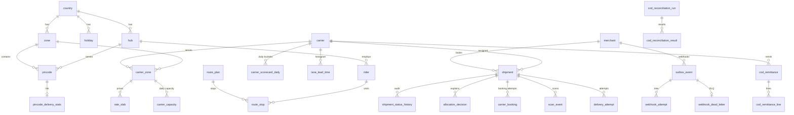
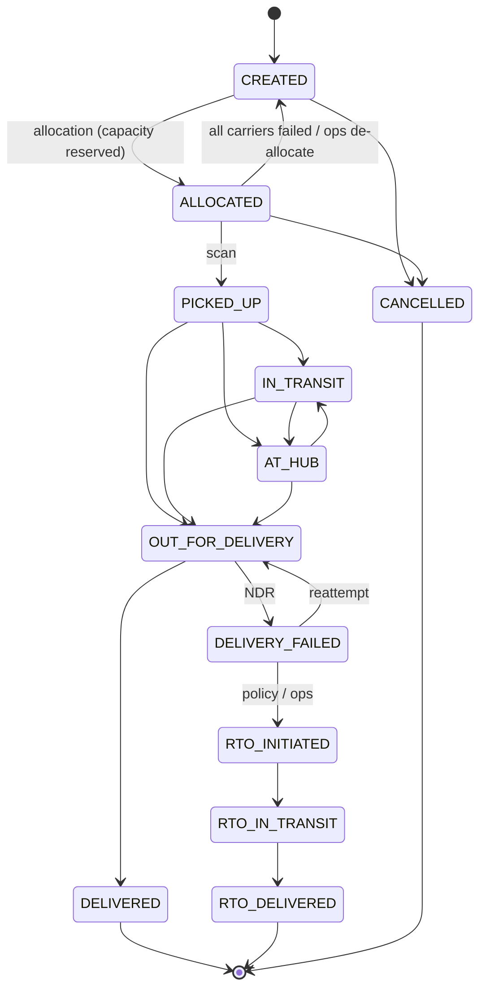
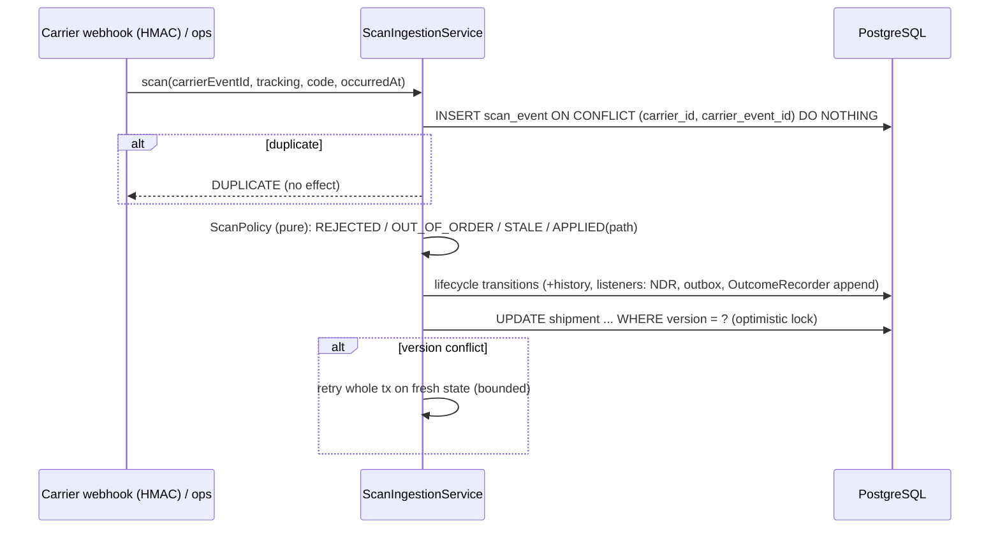

# ShipFlow – Architecture

ShipFlow is a modular monolith (Spring Boot 3.3, Java 21, PostgreSQL 17). Each package is a bounded module:
`api` (controllers / DTOs) → `application` (use cases, transaction boundaries) → `domain` (pure logic, no Spring, no
I/O). Persistence uses JPA only for the `Shipment` aggregate (optimistic `@Version`); everything set-based or hot
(capacity, stats, outbox, idempotency, lists) uses `JdbcTemplate` with hand-written SQL.

## 1. Module map

| package | responsibility | key types |
|---|---|---|
| `booking` | idempotent create, bulk CSV, e-store adapters, carrier booking + failover, reconciler | `ShipmentBookingFacade`, `ShipmentBookingService`, `BulkUploadService`, `CsvShipmentParser`, `OrderAdapter`, `BookingOrchestrator`, `BookingReconciler` |
| `idempotency` | Idempotency-Key claim / replay / transient retry | `IdempotencyService`, `RequestHasher` |
| `allocation` | filters → weighted rules → atomic capacity reservation, explainable decision | `AllocationEngine` (pure), `CandidateFilter`, `AllocationRule`, `AllocationService` |
| `carrier` | carrier directory, rate cards, capacity, ports (adapters), circuit breaker + timeout gateway | `CarrierPort`, `CarrierGateway`, `CircuitBreaker`, `CapacityRepository`, `RateCard` |
| `shipment` | aggregate, state machine, lifecycle (audit + listeners), queries | `Shipment`, `ShipmentStateMachine`, `ShipmentLifecycle`, `ShipmentTransitionListener` |
| `scan` | scan ingestion (idempotent, out-of-order safe, optimistic locking) | `ScanPolicy` (pure), `ScanIngestionService` |
| `ndr` | failed-delivery handling, reattempt policy chain, auto-RTO, NDR report | `ReattemptPolicy`, `ReattemptPolicyChain`, `NdrService` |
| `cod` | remittance upload + reconciliation (MATCHED/SHORT/EXCESS/MISSING) | `CodReconciliationService` |
| `stats` | write-behind outcome log → scorecard / lane / risk counters | `OutcomeRecorder`, `StatsDeltas` (pure), `StatsAggregator` |
| `scorecard` | Feature A: rolling, Bayesian-smoothed carrier scorecards | `ScorecardMath` (pure), `CarrierScorecard` |
| `risk` | Feature C: explainable rule-based delivery-risk score | `RiskRule`, `RiskEngine` |
| `edd` | Feature D: promise date from cut-off, calendars and lane lead-time percentiles | `PromiseDateCalculator` (pure), `BusinessCalendar`, `EddService` |
| `routing` | Feature E: sweep clustering + nearest-neighbour + 2-opt vs naive baseline | `RoutingAlgorithm`, `ClusteringStrategy`, `RouteSequencer` |
| `webhook` | transactional outbox, HMAC-signed delivery, backoff, DLQ | `OutboxWriter`, `WebhookDispatcher`, `BackoffPolicy`, `WebhookTransport` |
| `tracking` | public tracking by tracking number (no PII) | `TrackingController` |
| `security`, `observability`, `common`, `config` | JWT roles, HMAC, correlation ids + metrics, errors/money, typed config | `SecurityConfig`, `HmacSigner`, `ShipFlowMetrics`, `ShipFlowProperties` |

## 2. Extension contracts (Open/Closed – add a bean, change nothing else)

| contract | add a… | contract rules |
|---|---|---|
| `CandidateFilter` | hard allocation constraint | return a rejection reason or empty; evaluated in `@Order`; first rejection is stored in the explanation |
| `AllocationRule` | soft scoring rule | `score()` in [0,1] relative to the pool (1 = best); weight from `shipflow.allocation.weights.<key>` (0 disables); may adapt weight to context (`FirstAttemptRule` doubles for HIGH risk) |
| `CarrierPort` | carrier integration | `book` idempotent on `bookingRef`; `CarrierRejectedException` = business rejection, any other exception = technical (feeds circuit breaker); `lookup` for reconciliation; never called inside a transaction (`CarrierGateway` enforces it) |
| `OrderAdapter` | e-store (Shopify, Salla …) | map payload → `CreateShipmentRequest`; `externalOrderId` is the natural idempotency key |
| `RiskRule` | risk signal | pure function of `RiskInput`; returns points ≤ `maxPoints()` with a human reason; built-in budgets sum to 100 (address 30, COD 25, pincode 25, customer 20) |
| `ReattemptPolicy` | NDR decision | chain of responsibility; return empty to defer; default REATTEMPT |
| `ShipmentTransitionListener` | side effect of a state change | runs synchronously in the transition's transaction; must be cheap and must not touch shared hot rows (append, don't update – see ADR-011) |
| `ClusteringStrategy` / `RouteSequencer` / `RoutingAlgorithm` | routing heuristic | capacity respected; unassignable stops go to overflow |
| `WebhookTransport` | outbound transport | returns HTTP status; 2xx = delivered |

Built-ins: filters `excluded, integration, cod, weight, circuit-breaker, capacity`; rules `cost, sla, capacity,
on-time, first-attempt, rto`; risk `ADDRESS_QUALITY, COD_AMOUNT, PINCODE_FAILURE_RATE, CUSTOMER_HISTORY`; NDR
policies `ImmediateRtoReasons`, `MaxAttempts`.

SOLID notes: the pure cores (`AllocationEngine`, `ScanPolicy`, `ShipmentStateMachine`, `PromiseDateCalculator`,
`ScorecardMath`, `StatsDeltas`, `RiskEngine`, routing algorithms, `BackoffPolicy`, `CircuitBreaker` with an injected
`Clock`) have no framework or I/O dependencies and are unit-tested directly; services depend on interfaces
(`CarrierPort`, `WebhookTransport`, rule lists), so tests and new carriers swap implementations without edits.

## 3. Data model (ER)



Not shown (no FKs by design): `idempotency_record` (UNIQUE scope + key, TTL-purged), `customer_delivery_stats`
(keyed by SHA-256 of the normalised phone – no raw PII in stats), `delivery_outcome` (append-only, drained).

Key constraints that carry correctness:
- `carrier_capacity` CHECK `reserved <= capacity`, PK `(carrier_id, zone_code, service_date)` – the reservation is a
  single conditional UPSERT (`... ON CONFLICT DO UPDATE SET reserved = reserved + 1 WHERE reserved < capacity`).
- `scan_event` UNIQUE `(carrier_id, carrier_event_id)` – scan idempotency.
- `shipment` UNIQUE `(merchant_id, merchant_order_ref)`, UNIQUE `tracking_number`; `version` column for optimistic locking.
- `carrier_booking`: UNIQUE `booking_ref`, UNIQUE `(shipment_id, carrier_id)`, partial UNIQUE "one PENDING/CONFIRMED/UNKNOWN booking per shipment".
- `allocation_decision`: partial UNIQUE "one RESERVED decision per shipment".
- `idempotency_record`: UNIQUE `(scope, idem_key)` + stored request hash.

Geo: plain `lat/lng` columns + haversine with a bounding-box pre-filter instead of PostGIS (ADR-008).

## 4. Shipment state machine



CREATED, ALLOCATED and CANCELLED are system-only (a scan can never target them). A scan that skips states
(e.g. ALLOCATED → OUT_FOR_DELIVERY) is applied along the shortest legal forward path and each intermediate step is
written to history with `inferred = true`. DELIVERY_FAILED and terminal states are never inferred. Ranks (CREATED 0 …
terminal 100) make late scans STALE instead of regressing the shipment.

## 5. Key flows

### 5.1 Idempotent booking with allocation and failover

```mermaid
sequenceDiagram
    participant C as Merchant
    participant F as ShipmentBookingFacade
    participant I as IdempotencyService
    participant DB as PostgreSQL
    participant A as AllocationService
    participant O as BookingOrchestrator
    participant G as CarrierGateway (breaker + timeout)
    C->>F: POST /shipments (Idempotency-Key)
    F->>I: claim(scope,key,hash)
    I->>DB: tx0: INSERT idempotency_record ON CONFLICT DO NOTHING
    alt key exists
        I-->>C: replay (same id) / 422 hash mismatch / 409 in progress
    end
    F->>DB: tx1: insert shipment, risk, EDD
    F->>A: allocate (reserve-last)
    A->>DB: rank candidates (1 query), write decision + ALLOCATED, flush
    A->>DB: reserve capacity (conditional UPSERT) – last statement
    alt race lost (capacity just ran out)
        A-->>F: CapacityRaceLostException → whole tx1 rolls back, retried (claim kept); final attempt reserve-first
    end
    F->>DB: idempotency COMPLETED (same tx1) + commit
    F->>O: book (no tx open)
    O->>DB: tx2: claim carrier_booking (booking_ref, lease)
    O->>G: book(booking_ref)
    alt Booked
        O->>DB: tx3: CONFIRMED, AWB on shipment
    else Rejected / technical failure / breaker open
        O->>DB: tx3: FAILED, release capacity, re-allocate excluding failed carriers (bounded)
    else Timeout (uncertain)
        O->>DB: tx3: UNKNOWN – no failover; BookingReconciler asks carrier.lookup(booking_ref)
    end
    F-->>C: 201 shipment (+ allocation explanation, risk, EDD)
```

No carrier call ever happens while a transaction or row lock is held. Double-booking is prevented by
(a) a stable `booking_ref` the carrier must be idempotent on, and (b) never failing over on an *uncertain* outcome.

### 5.2 Scan ingestion



### 5.3 Outbox webhooks

`OutboxWriter` inserts `outbox_event` in the business transaction. `WebhookDispatcher` claims due rows with
`FOR UPDATE SKIP LOCKED` + a lease (multiple instances never send the same event concurrently), POSTs outside the
transaction with `X-ShipFlow-Signature: t=<epoch>,v1=<hex HMAC-SHA256(secret, t + "." + body)>`,
`X-ShipFlow-Event-Id` (consumer dedupe key), records each `webhook_attempt`, reschedules with exponential backoff +
equal jitter, and after `max-attempts` moves the event to `webhook_dead_letter` (admin replay endpoint).
Semantics: at-least-once; no per-shipment ordering guarantee (documented limitation).

### 5.4 Write-behind statistics

```mermaid
sequenceDiagram
    participant L as ShipmentLifecycle (scan tx)
    participant R as OutcomeRecorder
    participant DB as PostgreSQL
    participant A as StatsAggregator (every 1 s)
    L->>R: DELIVERED / DELIVERY_FAILED / RTO_INITIATED
    R->>DB: INSERT delivery_outcome (append-only, no shared row)
    A->>DB: tx: DELETE ... WHERE id IN (SELECT ... LIMIT n FOR UPDATE SKIP LOCKED) RETURNING *
    A->>A: StatsDeltas.of(batch) – one increment per (carrier,zone,day), lane, pincode, customer; keys sorted
    A->>DB: batched UPSERT += into scorecard / lane_lead_time / pincode / customer stats; commit
```

## 6. ADRs

**ADR-001 Modular monolith, not microservices.** One deployable, module boundaries by package; the hard
consistency problems (capacity, idempotency, state) are solved by one ACID database. Splitting later is possible along
the module seams (outbox already decouples side effects).

**ADR-002 Capacity as a conditional UPSERT + CHECK, no application locks.** `INSERT … ON CONFLICT DO UPDATE …
WHERE reserved < capacity` is atomic per row; the CHECK constraint is the last line of defence. Verified by a
200-thread IT (exactly the capacity is allocated) and the benchmark invariants (`overbooked = 0`).

**ADR-003 Reserve-last optimistic allocation.** Measured: the capacity row is the hottest row in the system; with
reserve-first it is locked for the whole booking transaction. Reserving as the *last* statement shrinks the lock hold
to ~commit time. A lost race (capacity filled meanwhile) throws `CapacityRaceLostException`; the transaction is
retried while the idempotency claim is still held; the final attempt falls back to reserve-first (falls through the
ranked list). Bulk CSV, failover and reallocation keep reserve-first (simpler, not latency-critical). Numbers in
PERFORMANCE.md.

**ADR-004 Idempotency claim in its own committed transaction.** Concurrent duplicates block on / see the claim
immediately; the effect and the COMPLETED marker commit atomically; failures delete the claim. Replays return the
resource id and re-read current state (not a frozen body).

**ADR-005 Carrier calls outside transactions; uncertain = no failover.** `CarrierGateway` refuses to run inside a
transaction. Circuit breaker (count-based ring buffer, half-open trials) + hard timeout on a virtual thread. Timeouts
become UNKNOWN and are reconciled via `lookup(booking_ref)`, because failing over could create a second consignment.

**ADR-006 Optimistic locking for scans.** Scans for one shipment are rare-but-concurrent (carrier retries,
duplicates). `@Version` + retry is cheaper than `SELECT … FOR UPDATE` on every scan and still makes stale decisions
impossible to commit. Event-time + rank rules make the result independent of arrival order.

**ADR-007 Transactional outbox with SKIP LOCKED instead of a broker.** No Kafka/RabbitMQ needed at this scale;
exactly the same at-least-once contract, horizontally scalable workers, no dual-write problem.

**ADR-008 lat/lng + haversine + bounding box instead of PostGIS.** Hub-local routing works on hundreds to a few
thousand stops in memory; a bounding-box pre-filter on indexed columns is enough. PostGIS would add an extension
dependency for no measured benefit. Revisit for city-wide nearest-hub search at scale.

**ADR-009 Ratio scoring for cost/SLA, Bayesian smoothing for quality.** Min-max normalisation made the cheapest
carrier score 1 and everyone else ~0, so cost dominated and scorecards never moved allocation (found by test).
`cheapest / own price` keeps differences proportional. Quality rates use `(successes + prior·k)/(n + k)` so a new
carrier with 2 deliveries is neither a hero nor a villain.

**ADR-010 Deterministic, explainable risk score (not ML).** Every point is attributable to a rule and a reason
string, which ops can act on (OTP, verification call, prepaid nudge) and which can be audited. ML can later replace a
rule behind the same `RiskRule` contract.

**ADR-011 Write-behind statistics.** Measured: per-scan `UPSERT +=` on `lane_lead_time` / `carrier_scorecard_daily`
made every DELIVERED scan of a lane queue on the same row (avg 12 lock waiters at 50 threads). Outcomes are now
appended in the scan transaction (exactly-once with the transition) and folded in batches by `StatsAggregator`
(claim + apply in one transaction ⇒ exactly-once; SKIP LOCKED ⇒ multiple instances; sorted keys ⇒ no deadlocks).
Trade-off: scorecards / lane histograms / risk stats lag by up to the flush interval (1 s default), which is
irrelevant for signals aggregated over days.

**ADR-012 No Redis.** Every measured bottleneck was row contention or commit fsync in PostgreSQL, which a cache
does not remove. Small read-mostly reference data (carriers, calendars, network) is cached in-process with explicit
invalidation on admin writes.
